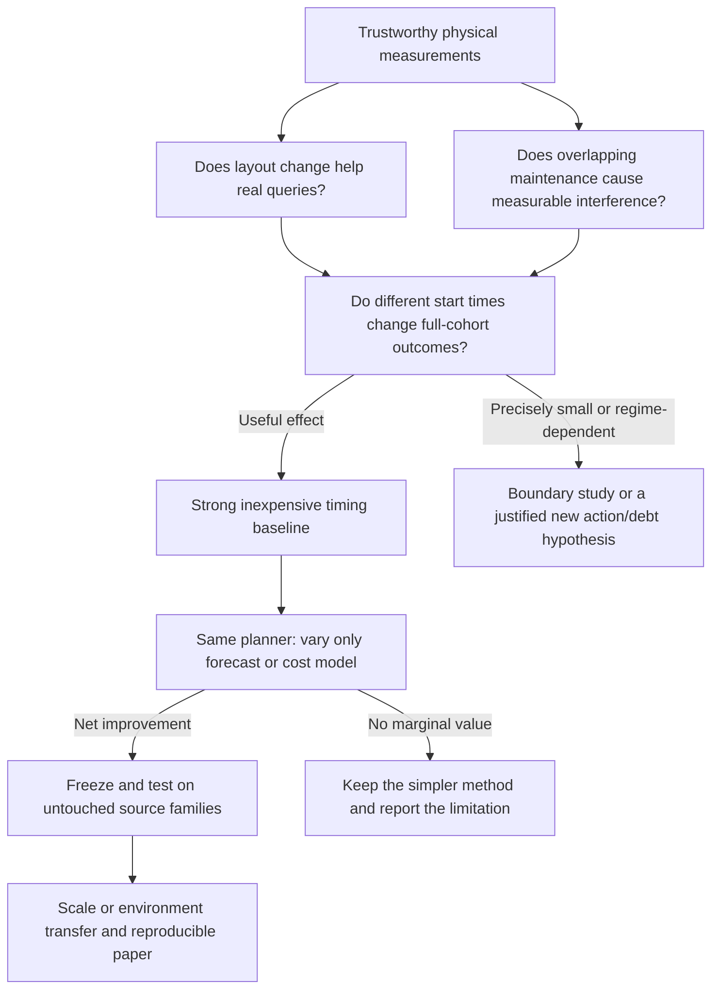

# Capstone research programme: improve measured outcomes, then justify the method

**Working version: 13 November 2026.** This is the prospective research and implementation programme. It does not replace historical protocols or turn failed experiments into successful data. Current user instruction: work locally and skip SSH. Physical collection remains pending a fresh worker3 registration and actual admission checks.

The project goal is to reduce the cost users experience while a lakehouse performs necessary maintenance. The first objective is **lower mean arrival-to-result response time for the same offered query cohort and completed maintenance obligation**. CPU work, I/O work, tail latency and maintenance completion are measured alongside it. A model, diagram, audit or new feature is useful only when it helps establish or achieve this outcome.

Our recommendation is to narrow the project to one decision first: **when should one eligible Iceberg compaction start?** Hold what to compact, the dataset, the rewrite options and the query mapping fixed. Prove that this decision matters. Then ask whether forecasts and learned costs improve it over a strong inexpensive rule. Separate A/B models are optional; keeping three models is not the goal.

## Read in this order

1. [Research strategy and execution sequence](01_research_strategy.md): the question, first 72 hours, longer schedule, decision gates and stop rules.
2. [Experiment catalogue](02_experiment_catalogue.md): 34 individually documented experiments, each with its hypothesis, intervention, controls, evidence and interpretation.
3. [Variables, metrics and statistical design](03_variables_metrics_statistics.md): which variables to freeze, which interactions to screen, exact metric definitions and fair comparisons.
4. [Models, controller and improvement branches](04_models_controller_and_branches.md): candidate architecture, bounded hyperparameters, ablations and alternate routes.
5. [Implementation and next-agent handover](05_implementation_and_handover.md): code map, actual validation status, commands, missing work and ownership.
6. [Literature and publication argument](06_literature_and_publication.md): primary-source positioning, competing methods, possible claims and paper structure.
7. [Experiment record template](EXPERIMENT_RECORD_TEMPLATE.md): mandatory record for every future unit.
8. [Current unit status](STATUS.md): what this turn actually implemented, checked or left pending.

The machine-readable counterpart is `three_model_maintenance/protocols/research_program_20261113.json`. Its designs are explicitly **unbound plans**: no source families, tables or physical outcomes are invented. The code is in `three_model_maintenance/research/`.

## Goal and decision ladder

**Immediate priority:** finish the prospective ownership/terminal-evidence repair, obtain a fresh matched control/maintenance block, and establish useful start-time effects. Do not begin a large model sweep, SF100 campaign, new storage-format migration or dashboard redesign before those gates.

**Infrastructure budget:** allow one focused repair unit and one fresh verification block, with a planning cap of two working days. A failure preserves evidence and stops dependencies. Continuing beyond the cap requires a documented mechanism diagnosis and a reason the repair can unlock the target metric. This is a limit on effort, not permission to relax evidence gates or kill an in-flight operation.

**Publication position:** a defensible paper needs a precise claim, fair comparisons, enough independent evidence and a reproducible artifact. We cannot guarantee acceptance or obtain novelty by combining familiar models. A negative result is useful only if it explains an important boundary with adequate precision; a broken experiment is not a negative scientific result.
